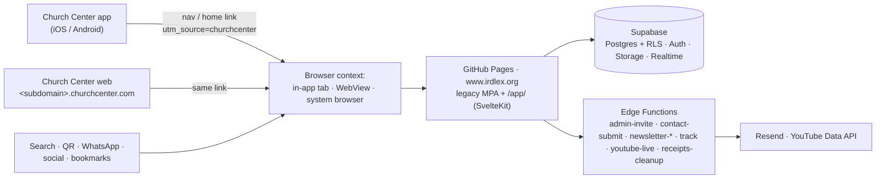

# Target architecture

> Snapshot 2026-10-18 · repo `f3b8c94`. Builds on the locked migration target (`MIGRATION.md` §0:
> SvelteKit + adapter-static, Svelte 5 runes, TypeScript; same Supabase backend, Edge Functions and
> RLS) and adds what the Church Center research requires. Decisions: ADR-0001 to ADR-0004
> (ledger D-029 to D-032).

## 1. Principles

1. **One website, many entry points.** Church Center links out to the same URLs that search,
   QR codes and WhatsApp use (ADR-0001). Nothing in the app depends on how the visitor arrived.
2. **Assume the least capable context.** A page may open in an in-app browser tab, an embedded
   WebView or the system browser (R6), so it must work without popups, a service worker,
   persistent storage or third-party cookies, and improve progressively when they exist.
3. **RLS is the security boundary** (D-002). The client holds the anon key; UI gating is UX only (D-006).
4. **Prerender public pages; render the admin in the browser.**
5. **No abstraction without a consumer.** Church Center-specific code exists only where a measured
   need (CC1) puts it.

## 2. System context

Planning Center is configuration only (navigation items). No data flows between Planning Center
and irdlex.org.

## 3. Layers and dependency rules (`web/`)

| Layer | Path | Purpose | May import | Must not import |
|---|---|---|---|---|
| Public routes | `src/routes/(public)`, `(bare)` | Prerendered pages and their loads | everything below | — |
| Admin routes | `src/routes/(admin)` (S37, `ssr=false`) | The staff application | everything below | — |
| Feature components | `src/lib/components/site/*` (and `admin/*` later) | Composed UI bound to data | primitives, repos, stores, platform, pure libs | `db/client` directly |
| Primitives | `src/lib/components/*.svelte` | Presentational design-system components | pure libs, their own host stores (toast, confirm, lightbox, action sheet) | `db/*`, `repos/*`, `platform/*` |
| Repos | `src/lib/repos/**` | The **only** code that calls `supabase.from / .rpc / .storage / .functions.invoke`; returns typed results (ADR-0004) | `db/client`, pure libs | components, stores |
| DB client | `src/lib/db/client.ts` | The typed Supabase client | config | — (importers: repos, the S38/S39 auth module) |
| Stores | `src/lib/stores/*.svelte.ts` (+ S38 `session` / `perms` / `ministries`) | App state as rune stores | repos, pure libs | components |
| Platform | `src/lib/platform/*` (create only when CC1 shows a need) | Entry context and capability helpers; the only code that knows "churchcenter" | pure libs | everything else |
| Pure libs | `src/lib/*.ts` (money, sanitize-html, validators, waiver, pdf, date, …) | Logic with golden tests | each other | DOM-dependent code except where documented (pdf, sanitize-html) |
| Styles | `src/lib/styles/**` | Tokens, base, layout, utilities ([design-system.md](design-system.md)) | — | — |

Enforcement (S05b): ESLint `no-restricted-imports` overrides per path, plus the existing
`local/no-raw-html` rule (G-029). Feature components may call repos; that is an explicit choice so
that S23's `site/Newsletter.svelte`, which already imports a repo, stays legal. Primitives may not.

## 4. Routing and navigation

- **Stable URLs (D-001).** Every legacy URL keeps answering at the same path, trailing slash
  included, so Church Center links, QR codes and bulletins never need editing. The query-string
  detail pages (`/eventos/evento.html?id=`, `/eventos/evento-especial.html?e=|?id=`,
  `/eventos/registro.html?e=|?id=`, `/discipulado/grupo/?slug=|?id=`, `/galeria/album/?slug=|?id=`,
  `/eventos/?view=…`) stay valid; S28's redirect stubs must forward `location.search` and the hash.
- **Rendering:** public routes are prerendered (`trailingSlash: 'always'`). The admin group uses
  `ssr=false` with a fallback, constrained by G-021 (Pages serves only the root `404.html`).
- **Back navigation:** every meaningful view state is a URL (`?view=`, admin tabs as routes in
  S37). Full-screen overlays — Lightbox, the mobile ActionSheet, a phone-width FormWizard — use
  SvelteKit **shallow routing** (`pushState` / `replaceState` from `$app/navigation`, read through
  `page.state`), so the Android back gesture and iOS swipe-back close the overlay instead of leaving
  the page.
- **Outbound links:** same-tab by default. In-app contexts handle `target="_blank"` inconsistently
  (R6). Keep `rel="noopener"` where a new tab is used.
- **Into Church Center:** plain `https://<subdomain>.churchcenter.com/...` links, which open the app
  through Universal/App Links (R18). Never custom URL schemes.

## 5. Authentication, authorization, sessions

- **Identity provider:** Supabase Auth only (ADR-0001). Email + password; TOTP enforced for `/admin`
  per D-010 (client redirect plus an `aal2` RLS check, S39; G-016).
- **Email links** (invite, recovery) use `token_hash` + `verifyOtp` on the landing page, so they
  complete in **whatever browser the mail app opens**. Don't switch the templates to PKCE
  `ConfirmationURL` links: PKCE keeps the code verifier in the browser that *requested* the email,
  which fails when the email is opened elsewhere.
- **Sessions per context:**

  | Context | Storage relationship | What staff experience |
  |---|---|---|
  | Safari / Chrome | Normal; WebKit deletes script-writable storage after 7 days without interaction ([WebKit](https://webkit.org/tracking-prevention/)) | Occasional re-login |
  | iOS in-app browser tab (SFSafariViewController) | Separate from Safari ([Apple](https://developer.apple.com/documentation/safariservices/sfsafariviewcontroller)) | Sign in again inside Church Center; persistence across relaunch measured in CC1 |
  | Android Custom Tab | Shares Chrome's cookies/storage ([Chrome](https://developer.chrome.com/docs/android/custom-tabs)) | Likely already signed in |
  | Embedded WebView | App-defined; may not persist | Possible sign-in every time |

- **Required behavior (S38/S39):**
  - Subscribe to `onAuthStateChange`. On a failed refresh or `SIGNED_OUT`, show a Spanish
    "Tu sesión expiró" screen with sign-in, never a raw error.
  - Never assume a session started in another context.
  - Never use popups or redirect chains for auth.
- **Accessible authentication (WCAG 3.3.8):** allow paste and password managers;
  `autocomplete="username"` / `"current-password"` / `"new-password"`; the code field uses
  `inputmode="numeric"` and `autocomplete="one-time-code"`.
- **Configuration:** add the `/app/` paths to the Supabase Auth redirect allow-list before S39.
- **If social login is ever considered:** Google blocks OAuth in embedded WebViews
  ([Google OAuth policies](https://developers.google.com/identity/protocols/oauth2/policies)); RFC 8252
  §8.12 forbids embedded user-agents for authorization ([RFC 8252](https://www.rfc-editor.org/rfc/rfc8252)).
- **Authorization:** RLS policies are the guard; `visibleSurfacesFor(profile)` (D-006) only shapes
  navigation.

## 6. Data access

- Repos implement ADR-0004: `ReadResult` / `WriteResult` with a typed `RepoError`; never throw;
  error ≠ empty.
- Date ranges are pushed into queries (S52); long lists paginate or sum server-side (G-033).
- Literal `.select()` column strings (G-024). Anonymous inserts don't chain `.select()` (G-006).
- Realtime subscriptions return an `Unsubscribe` and are torn down on route leave (S62). In-app
  browsers suspend background sockets, so refetch on `visibilitychange`.

## 7. State

Rune stores per domain (`toast`, `confirm`, `lightbox`, `theme`; S38 adds `session`, `perms`,
`ministries`). Permissions derive from the profile; no global store library.

## 8. Entry context (the only Church Center-aware code)

- **Entry marker:** on the first page view, read `utm_source`; if it is `churchcenter`, store
  `ird.entry=churchcenter` in sessionStorage, because the UTM disappears after the first click. Use it
  for analytics dimensions and optional copy only — **never** to enable or disable features.
- **No user-agent sniffing for context:** in-app browser tabs report the system browser's user agent,
  and the collector's `browserOf()` can't recognize them
  (`supabase/functions/track/index.ts`). The existing `detect-device.ts` stays for its one legacy
  parity use (add-to-calendar).
- **Capability helpers** (`openExternal`, `saveFile`, `share`) are created in `src/lib/platform/` only
  if CC1 shows real failures. Each feature-detects and falls back: same-tab navigation, then the
  share sheet, then instructions.

## 9. Errors and observability

- `+error.svelte` per route group, in Spanish; `<svelte:boundary>` around independently loaded
  sections, so one failed fetch doesn't blank the page.
- Logging stays `console.warn/error` with a `[module]` tag (house rule; no `console.log`).
- Analytics: the first-party `track` collector (D-026) records path, allowlisted query keys, `utm_*`
  and referrer host, including Android `android-app://` referrers. GA4 continues alongside it.
- **Optional, owner approval required:** a client error report through the existing `track` endpoint
  (route, error kind, no personal data), to see failures in contexts where users can't report them.

## 10. Performance

- Prerendered HTML for every public route; images through the existing WebP pipeline; YouTube behind
  a click-to-load facade (S23).
- Per-route JS budgets measured in S05b and then ratcheted ([testing-and-rollout.md](testing-and-rollout.md)).
- No large payloads on page load. The port computes the daily verse at build time (S23) instead of
  downloading a multi-megabyte file.

## 11. Security target controls

| Control | Mechanism | Owner |
|---|---|---|
| Data access | RLS on every table; least-privilege policies; `aal2` for admin writes | S39, migrations |
| Rendering | Svelte escaping by default; `{@html}` only on sanitizer output (D-005, lint-enforced G-029) | all sessions |
| Dependencies | npm lockfile, exact versions for anything loaded at runtime from a CDN, `npm audit` in CI | S05b |
| Content Security Policy | SvelteKit `csp` in hash mode, emitted as `<meta>` on prerendered pages | S65 (earlier if cheap) |
| Framing | `frame-ancestors` can't be set by `<meta>` ([MDN](https://developer.mozilla.org/en-US/docs/Web/HTTP/Reference/Headers/Content-Security-Policy/frame-ancestors)) and Pages can't send headers → a script frame-guard on admin routes | S37 |
| Secrets | Only `PUBLIC_*` values in the client (D-007); service keys live in Edge Functions | all |
| Public endpoints | Edge Functions validate origin and input and rate-limit where they send email | Edge Functions |
| Verification standard | OWASP ASVS 5.0 ([project](https://owasp.org/projects/asvs)): Level 1 for public surfaces; Level 2 for V6 Authentication, V7 Session Management, V8 Authorization on the admin | per session |

## 12. Deployment and environments

- One GitHub Pages artifact (D-008): the legacy site at the root and the SvelteKit build under
  `/app/` until each surface cuts over, then `BASE_PATH=''` (G-008) and legacy removal (S65).
- Configuration through `PUBLIC_*` variables injected from GitHub Secrets (D-007).
- Node 24 in CI satisfies SvelteKit 3's ≥ 22.17 floor.
- One production Supabase project. The PII rule requires a **staging** project for any end-to-end
  test that submits registrations or interests (`docs/migration/VERIFICATION.md`). Whether one exists
  is an open owner question ([migration-roadmap.md §5](migration-roadmap.md#5-owner-decisions)).
- The legacy service worker (scope `/`) currently intercepts `/app/*` (G-034). S35 replaces it;
  until then, port pages must not rely on it.

## 13. Where Church Center appears

Only in: Planning Center configuration (outside the repo), the `utm_source=churchcenter` value and
its analytics reading, `src/lib/platform/` if it is ever created, and these docs. A change of
integration touches nothing else.
